# Lab 02 — Web Application Firewall with SafeLine (Reverse-Proxy WAF)

> Protecting an Apache website behind the SafeLine WAF over HTTPS, attacking it from Kali, and tuning the WAF after finding a command-injection payload that was **detected but not blocked**.

     

**Author:** Ousmane Cisse — MSc Computer Science (Cybersecurity), ELTE Budapest
**Series:** 5 Free Cyber Home Labs — Lab 02 / 05 · [Lab 01 — Wazuh SIEM](https://github.com/CISSE3/wazuh-lab-01)
**Date:** 25 October 2026

---

## Key results
| | |
|---|---|
| ✅ HTTPS site served **only** through the WAF | origin port refused from the LAN |
| ✅ SQLi, XSS, command injection, path traversal | **403 / 400 — blocked** |
| ✅ Normal traffic | **200 — no false positive** |
| ⚠️ Nikto LuCI command-injection payload | **Detected as CMD Inj but only *Audited*** → reached origin |
| ✅ Custom deny rule (`$(` OR `%24%28`) | **404 → 403**, 2 hits, normal traffic still 200 |

---

## Table of contents
1. [Architecture](#1-architecture)
2. [Build](#2-build)
3. [Attack & verify](#3-attack--verify)
4. [Finding — detected ≠ blocked](#4-finding--detected--blocked)
5. [Tuning — custom rule](#5-tuning--custom-rule)
6. [Lessons learned](#6-lessons-learned--troubleshooting)
7. [Next steps](#7-next-steps)
8. [Skills](#8-skills-demonstrated)

---

## 1. Architecture

```
  Kali 172.16.134.128                 Ubuntu 24.04 · 172.16.134.129 (VMware NAT)
 ┌──────────────────┐  HTTPS :8443  ┌──────────────────────────────────────────────┐
 │ curl · nikto ·   │──────────────►│ SafeLine WAF 9.4.3 (Docker)                  │
 │ Firefox          │               │   tengine (host net) ── detector ── mgt :9443│
 └──────────────────┘               │              │ HTTP                          │
        ✗ :8080 refused             │              ▼                               │
                                    │   Apache 2.4  172.17.0.1:8080 (docker0 only) │
                                    │   (+ Wazuh SIEM from Lab 01 on :443)         │
                                    └──────────────────────────────────────────────┘
```

| Component | Detail |
|---|---|
| WAF | SafeLine CE 9.4.3, reverse proxy, mode **Defense** |
| Site | `shop.lab.local` → `https://shop.lab.local:8443` (self-signed cert, valid to 2027-10-25) |
| Origin | Apache bound to the Docker bridge `172.17.0.1:8080` → unreachable from the LAN |
| Attacker | Kali Linux (curl, Nikto 2.6.1) |
| Design note | WAF shares the Lab 01 SIEM host to save resources → app on **8443** because Wazuh owns 443. In production the WAF would run on its own host. |

## 2. Build

### 2.1 SafeLine
```bash
bash -c "$(curl -fsSLk https://waf.chaitin.com/release/latest/manager.sh)" -- --en
sudo docker exec safeline-mgt resetadmin      # (re)generate admin password
sudo docker ps --format "table {{.Names}}\t{{.Status}}"   # 7 containers Up
```
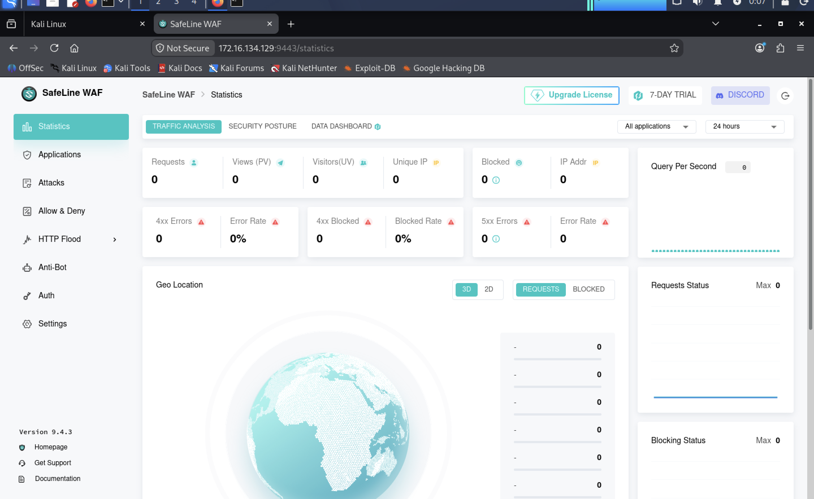

### 2.2 Origin — Apache on the Docker bridge only → [`scripts/01-setup-origin.sh`](scripts/01-setup-origin.sh)
```
Listen 172.17.0.1:8080
```
SafeLine rejects loopback (`127.0.0.1`) as an upstream ("special address not allowed"), so the origin is bound to `docker0`, which SafeLine's host-network proxy can reach but the LAN cannot.

### 2.3 Certificate → [`scripts/02-make-cert.sh`](scripts/02-make-cert.sh)
Self-signed `CN=shop.lab.local`, uploaded in *Settings → SSL Cert*.
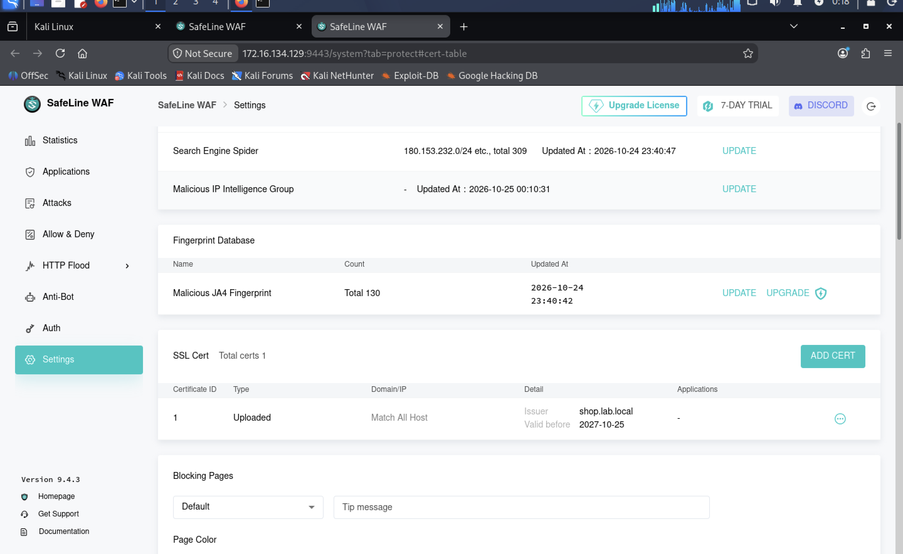

### 2.4 Application
| Field | Value |
|---|---|
| Domain | `shop.lab.local` |
| Port | `8443` HTTPS |
| Mode | Reverse proxy → `http://172.17.0.1:8080` |

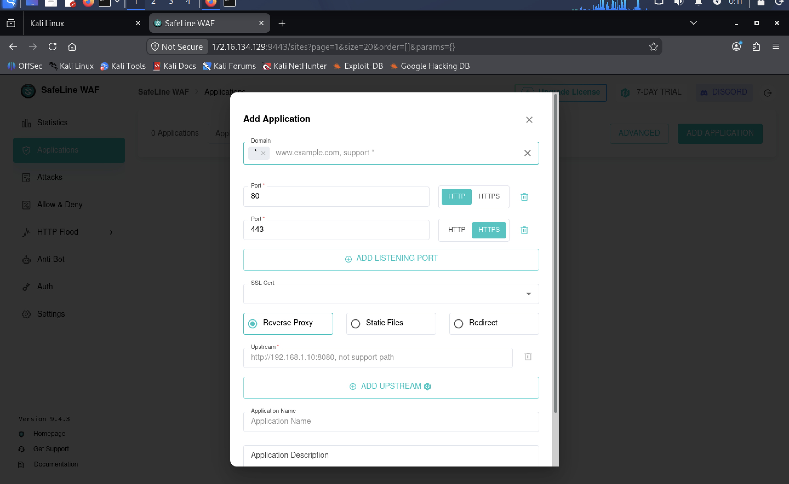
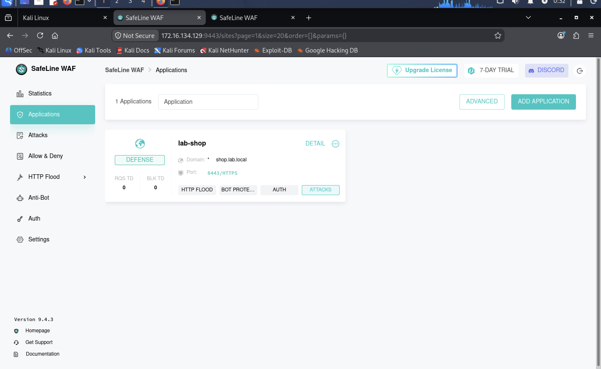

**Origin lock verified from Kali:**
```
curl -k https://shop.lab.local:8443      → <h1>Lab shop - protected by SafeLine</h1>
curl -m 5 http://172.16.134.129:8080     → Failed to connect (refused)
```
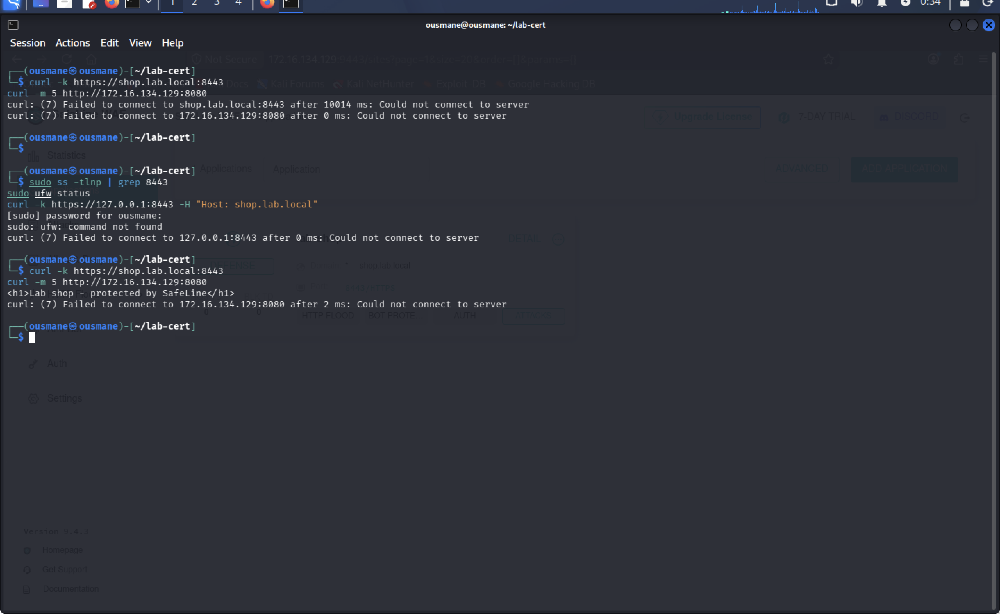

## 3. Attack & verify
→ [`scripts/03-attack-tests.sh`](scripts/03-attack-tests.sh)

| Request | HTTP | Handled by |
|---|---|---|
| `/?id=1' OR '1'='1` | **403** | WAF — SQL Inj |
| `/?q=<script>alert(1)</script>` | **403** | WAF — XSS |
| `/?cmd=;cat /etc/passwd` | **403** | WAF — Cmd Inj |
| `/../../etc/passwd` | **400** | Rejected by the proxy layer (malformed path) before detection |
| `/` | **200** | Allowed — no false positive |

**Nikto:** 8,216 requests in 37 s · `Server: No banner retrieved` (WAF hides the origin) · only findings = **missing security headers** (HSTS, CSP, X-Content-Type-Options, Permissions-Policy, Referrer-Policy).

Each block page carries an **event ID** (e.g. `e2ed06d4…`) that maps to the console log — useful when a user reports "I was blocked".

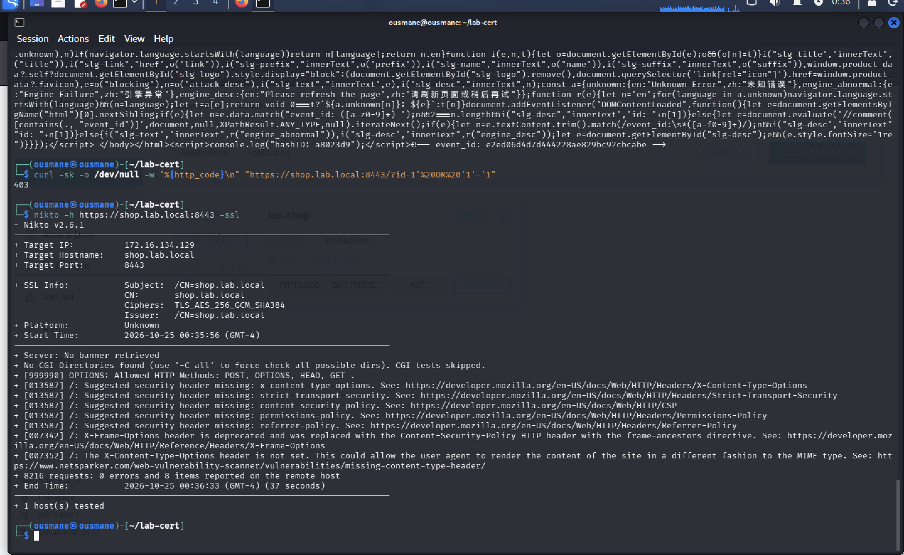
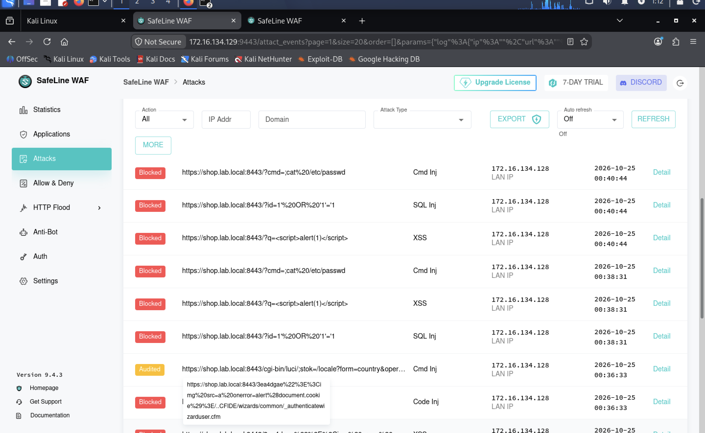
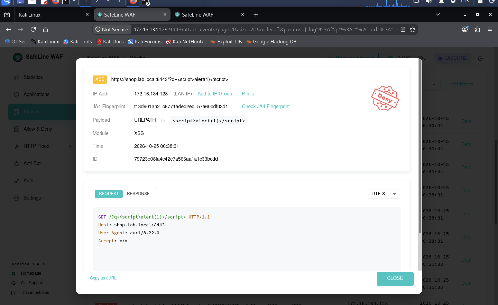

**Origin log** ([excerpt](docs/apache-access-log-excerpt.txt)): none of the SQLi/XSS/CMDi requests appear; only normal `GET /`, SafeLine's 60-second health check (`SafeLine-CE/v9-4-3` user-agent), and Nikto discovery probes (404). All requests come from `172.16.134.129` — the WAF host — never from Kali.

## 4. Finding — detected ≠ blocked
→ full write-up: [`docs/finding-WAF-2026-001.md`](docs/finding-WAF-2026-001.md)

Among Nikto's requests that reached Apache:
```
GET /cgi-bin/luci/;stok=/locale?form=country&operation=write&country=$(ls+/etc/)  → 404
```
| Field (SafeLine detail) | Value |
|---|---|
| Module | **CMD Inj** — classified correctly |
| Action | **Audited / Allow** — not blocked |
| Payload (normalised) | `$(ls /etc/)` (the `+` decoded to a space) |
| Client | Browser-like headers (`Sec-Fetch-*`) — but JA4 `t13d901100_…` ≠ a real browser |

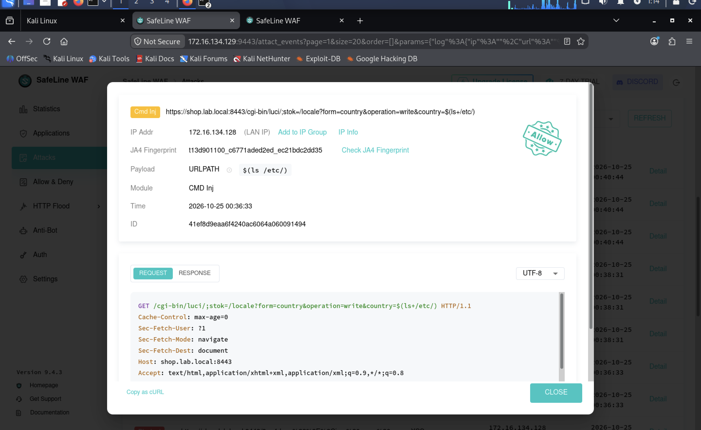

## 5. Tuning — custom rule
→ [`config/custom-rule-block-shell-substitution.md`](config/custom-rule-block-shell-substitution.md) · [`scripts/04-verify-tuning.sh`](scripts/04-verify-tuning.sh)

**Deny rule `block-shell-substitution`:** `URL contains $(` **OR** `URL contains %24%28`

| Test | Before | After |
|---|---|---|
| `$(ls+/etc/)` | 404 (passed) | **403** |
| `%24%28ls+/etc/%29` (encoded) | 404 (passed) | **403** |
| `/` | 200 | **200** |

The first version joined the two conditions with **AND** → impossible to match → 0 hits. Fixed to **OR** → 2 hits.

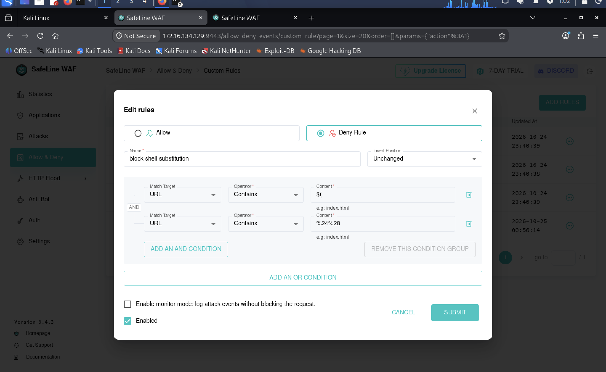
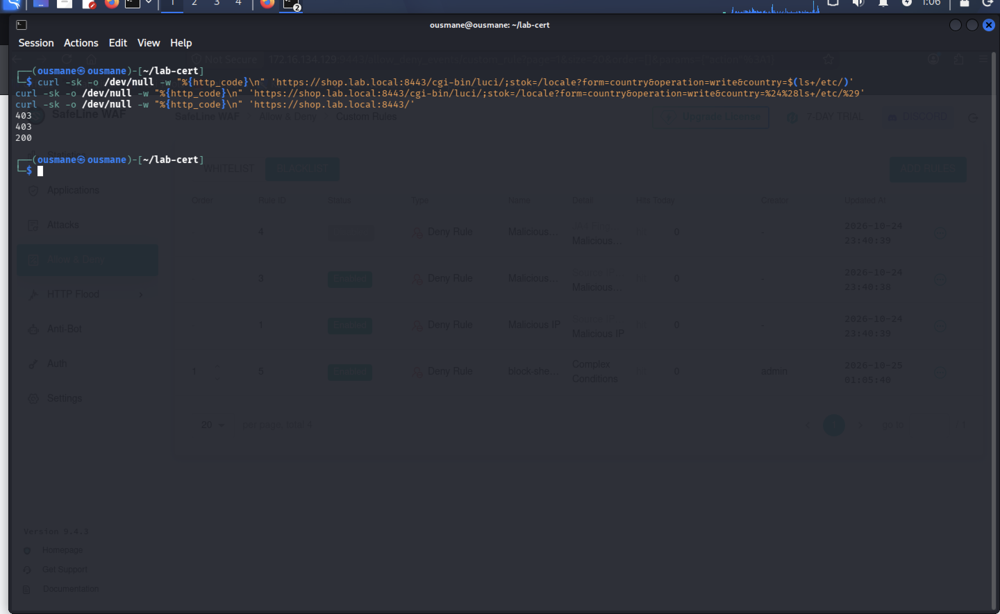
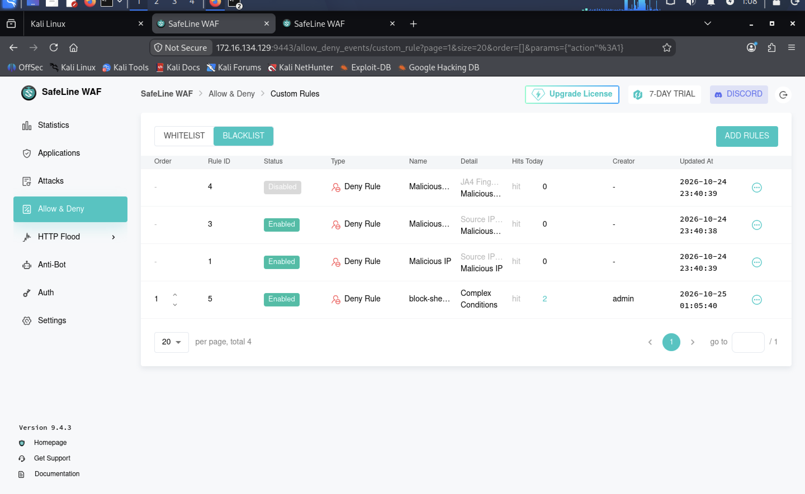

## 6. Lessons learned & troubleshooting

| Issue | Cause | Fix / lesson |
|---|---|---|
| `docker: permission denied` | User not yet in `docker` group | `sudo`, or `usermod -aG docker $USER` + `newgrp docker` |
| SafeLine installed on the SIEM host | Same hostname on every VM | Check `hostname -I` first; give VMs distinct hostnames |
| Port clash with Wazuh (443) | Two services, one host | App on **8443**, console on 9443 |
| `sed` didn't rebind Apache | Apache already on `Listen 8080` | Verify with `ss -tlnp` — **check, don't assume** |
| Upstream `127.0.0.1` refused | SafeLine blocks loopback upstreams | Bind origin to `docker0` (172.17.0.1) |
| Kali commands run on the wrong VM | Identical prompts | Look at the prompt / `hostname -I` before running |
| Path traversal = 400 not 403 | Proxy rejects malformed paths before the WAF engine | Test traversal in a parameter (`?file=../../`) to exercise detection |
| CMDi payload reached origin | Detected but scored *Audit* | Custom deny rule; review **Audited** events, not only Blocked |
| Rule had 0 hits | AND instead of OR | Test every rule with a positive **and** a negative case |
| Console times ≠ server times | Console renders in the browser's timezone (Kali UTC-4), Apache logs CET | Normalise timezones before building a timeline |

## 7. Next steps
- [ ] Add the missing security headers (Nikto findings) and re-scan.
- [ ] HTTP Flood rate-limit + Anti-Bot challenge; measure with a request loop.
- [ ] Compare Defense vs Audit mode on the same payload set.
- [ ] Ship SafeLine and Apache logs to the **Wazuh SIEM from Lab 01** → correlate WAF blocks with endpoint alerts.
- [ ] Run Chaitin's `blazehttp` benchmark to measure detection and false-positive rates.

## 8. Skills demonstrated
`WAF deployment` · `Reverse proxy & TLS` · `OpenSSL` · `Docker` · `Apache hardening` · `OWASP Top 10 testing (SQLi/XSS/CMDi/traversal)` · `Nikto` · `Log analysis` · `False-negative analysis` · `WAF rule authoring & tuning` · `JA4 TLS fingerprinting` · `Troubleshooting`

**Resume line:**
> Deployed SafeLine WAF as a TLS reverse proxy in front of an Apache origin locked to an internal Docker bridge; validated SQLi/XSS/command-injection blocking with curl and Nikto (0 false positives), identified a command-injection payload that was detected but only audited, and closed the gap with a custom OR-based deny rule (404 → 403).

---

### Repository layout
```
safeline-waf-lab-02/
├── README.md
├── config/
│   ├── apache-ports.conf.snippet
│   └── custom-rule-block-shell-substitution.md
├── docs/
│   ├── finding-WAF-2026-001.md
│   └── apache-access-log-excerpt.txt
├── scripts/
│   ├── 01-setup-origin.sh
│   ├── 02-make-cert.sh
│   ├── 03-attack-tests.sh
│   └── 04-verify-tuning.sh
└── screenshots/   (12 images)
```

> ⚠️ All testing was done against my own isolated lab VMs. No credentials or private keys are included in this repository.

## License
MIT — see [`LICENSE`](LICENSE).
